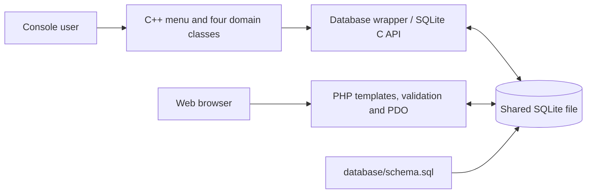

# Architecture

PeerLearn supports a second-year C++ OOP PBL on SDG 4: Quality Education. The Phase 2 console baseline was reconstructed from earlier documented prototypes. The four domain classes remain the core of the application; PHP supplies another interface to their shared persistence model.

## Components and data flow

| Component | Responsibility |
| --- | --- |
| `cpp/main.cpp` | Domain objects, console input, menu coordination, linear searches, progress calculations |
| `cpp/database.h` | Own SQLite connection; prepare, bind, step and finalize SQL statements |
| `database/schema.sql` | Common tables, constraints, triggers, indexes and derived view |
| `dashboard/bootstrap.php` | PHP session, CSRF protection, input validation, database connection, mutations and HTML helpers |
| `dashboard/index.php` | Six server-rendered sections and database-derived summaries |
| `dashboard/assets/` | Local CSS and small JavaScript enhancements |
| `scripts/` | Windows build and explicit additive database setup |
| `tests/integration.py` | Real console, HTTP and SQLite integration using temporary storage |

## Console request lifecycle

`main` constructs `Database storage`, initializes missing schema objects, and assigns its address to the non-owning `database` pointer. At each menu cycle, `refresh()` reads persisted records into four vectors using row constructors. Menu functions locate objects, check inputs, and call persistence or domain member functions. Successful changes are reloaded on the next cycle. SQL failures produce an operation error and return to the menu; startup failures exit with a nonzero code.

The wrapper disables copying so two objects cannot accidentally own the same SQLite handle. Its destructor closes the connection, and each prepared statement is finalized on both success and exception paths. Bindings use explicit string lengths. User-facing text rejects embedded NUL characters to avoid parser errors and truncation.

## Dashboard request lifecycle

A GET selects an allowlisted page, reads the database, and renders escaped HTML. A mutation requires POST and a matching session CSRF token. PHP validates fields, executes prepared SQL, stores a success/error message, then redirects with HTTP 303. Failed create/edit forms retain usable values; status/delete failures do not populate unrelated creation forms. SQL exceptions are logged; visitors receive a safe message. Unhandled infrastructure failures return an actionable HTTP 503.

The six sections are Overview, Students, Skills, Sessions, Feedback and Learning Progress. Counts and ratings come from SQL, not sample statistics. CSS adapts navigation, grids and tables for narrow screens. JavaScript confirms deletion of a named record and focuses server error feedback. Core creation and search work without JavaScript; native confirmation requires JavaScript.

## Persistence and synchronization

Both clients normally use `database/skill_exchange.db`. Run C++ from the repository root; PHP resolves its default path relative to its source. To select another file, pass its absolute path to C++ and set PHP's `SKILL_EXCHANGE_DB` to that same path before starting the server. `SKILL_EXCHANGE_SESSION_DIR` optionally selects private PHP session storage.

There is no C++/PHP API bridge: each process accesses SQLite directly. Foreign keys and a five-second busy timeout are enabled on both connections. SQLite file locks coordinate separate processes even though the single-threaded console is compiled with `SQLITE_THREADSAFE=0`. This is not a performance claim about many concurrent users.

Both clients inspect the expected schema object names and execute additive setup only when objects are missing. The explicit initializer always runs `CREATE ... IF NOT EXISTS`. Setup does not insert demonstrations, delete records or replace existing tables. These checks are not schema-version migration or validation of arbitrary older databases. Serve only `dashboard/` and keep database and session files outside the public document root.

## Boundaries

The program deliberately uses simple menu functions, private class members, vectors and prepared SQL. Shared global vectors and a non-owning database pointer keep the prototype approachable, but couple the modules and make isolated unit testing harder. Database-backed integration tests cover those boundaries instead. See [limitations and future scope](LIMITATIONS.md) for the supported deployment and known tradeoffs.
