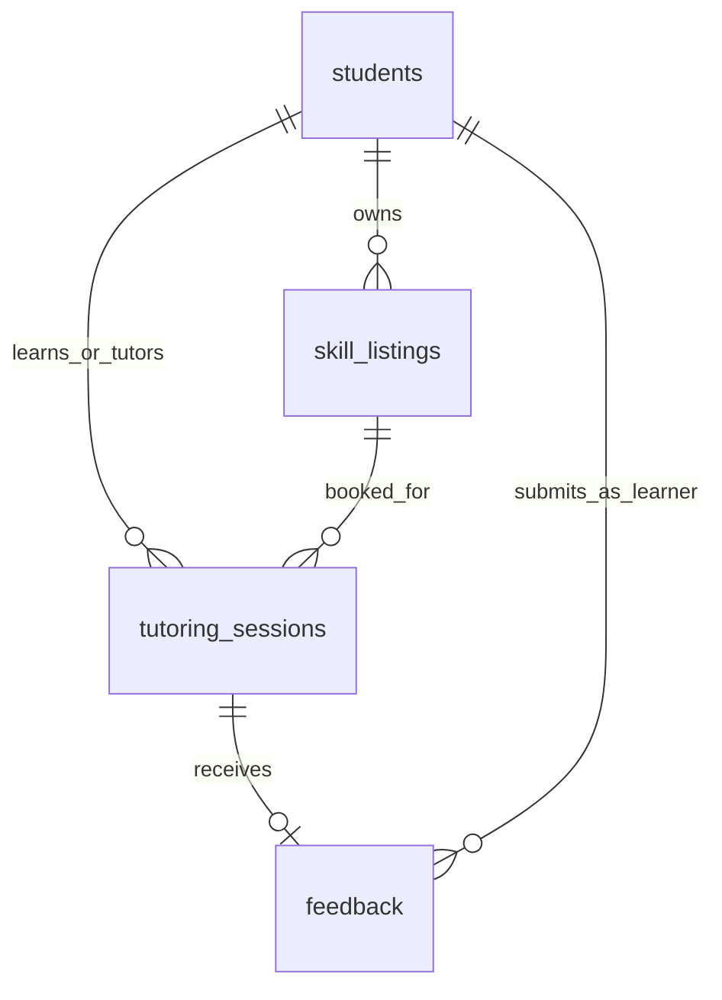

# Database design

The shared contract is `database/schema.sql`. SQLite stores four tables and a derived view. Both applications enable foreign keys for each connection; they are not assumed to be enabled globally.

## Tables and keys

| Table | Primary key | Other fields and references |
| --- | --- | --- |
| `students` | `id` | `name`, `skills_offered`, `skills_needed` |
| `skill_listings` | `id` | `student_id` → students; `skill_name`, `type`, `description` |
| `tutoring_sessions` | `id` | `listing_id` → listings; `learner_id`, `tutor_id` → students; `date`, `time`, `duration_hours`, `status` |
| `feedback` | `session_id` (also FK → sessions) | `student_id` → students; `rating`, `comments` |

IDs are positive integers no larger than 2147483647, matching C++ signed `int`. User-assigned IDs are not automatically renumbered. Feedback's primary key permits at most one review per session. Skills in a student's profile are descriptive text, not a normalized join to listings. Listing descriptions may change after booking, so historical session displays show the current listing skill name.

## Validation and relationships

- Names and skill names: 1–200 trimmed characters; profile skill text: 1–1000; descriptions and comments: 1–2000. PHP trims input, and C++ trims surrounding spaces, tabs and line endings. Database checks provide a final bound; console overlength text may fail at save time.
- Listing type is exactly `Offer` or `Learn`. Only existing Offer listings can be booked.
- Sessions require an existing learner distinct from the tutor. An insert trigger checks that the listing belongs to the specified tutor. New sessions start Pending.
- Dates must be real calendar dates from 1900 through 9999, written `YYYY-MM-DD`; times use 24-hour `HH:MM`. Duration is greater than zero and at most 24 hours. Dates have no timezone and are not required to be in the future.
- A session update trigger permits only Pending → Accepted/Rejected and Accepted → Completed. Completed and Rejected are terminal. Booking IDs, participants, date, time and duration are immutable.
- A booked listing cannot change its owner, type or ID. The console editing workflow only changes skill name and description; the dashboard allows owner/type changes while a listing remains unbooked.
- Feedback inserts require a Completed session and its actual learner. Ratings must have SQLite integer storage and be between 1 and 5. Review updates cannot change the session or learner identity.

Foreign keys use `ON DELETE RESTRICT`. Remove dependent feedback, then sessions, then listings, then students when intentionally deleting a demonstration chain. Referenced records are never cascade-deleted. Deleting a completed session after deleting its feedback also removes its contribution to progress; this application is not an immutable audit ledger.

## Derived learning progress

`learning_progress` left-joins students to their Completed sessions and groups by student ID. It returns ID, name, completed-session count and the sum of scheduled duration. A registered student with no completed sessions appears with zero count and zero hours. Feedback does not create hours, and deleting a review alone does not reduce hours.

Dashboard tutor averages group reviews by the session's tutor; overall averages aggregate all feedback. The console learner summary averages the reviews submitted by that learner. These are different perspectives, not a single rating stored twice. Unrated dashboard summaries show a dash; console summaries currently show 0/5.

## Indexes, SQL safety and initialization

Integer primary keys use SQLite's rowid B-tree. Additional indexes cover listing owner and session learner, tutor and listing IDs, supporting joins and dependent-record checks. There is no text search index or session-date index. Query costs depend on SQLite's planner; see [time complexity](TIME_COMPLEXITY.md).

Both clients bind data through prepared statements. Variable table/column names in edit and delete helpers come from fixed program allowlists. HTML is escaped separately; SQL binding is not HTML escaping. PHP also checks CSRF tokens, scalar form values and field rules before mutation. Schema triggers protect shared relationships if either interface submits an invalid change.

Ordinary connections inspect 14 expected schema object names. Missing objects trigger `CREATE ... IF NOT EXISTS`; the CLI initializer can run the same schema explicitly. Existing records and IDs remain intact. This is additive setup, not a versioned migration system, and does not compare the definitions of existing triggers or tables. Unsupported older layouts need a deliberate migration. Close both clients before copying the database for a backup. Keep the working file on a writable local filesystem; avoid concurrent cloud-sync edits while demonstrating SQLite.
